# Sobra

Controle financeiro pessoal que responde três perguntas: quanto você tem agora, para onde foi o
dinheiro este mês e quanto sobra. App mobile para lançar o gasto na hora, painel web para entender o
mês.

Projeto de portfólio (1 de 4). Os dados das capturas são do usuário demo, sintéticos.

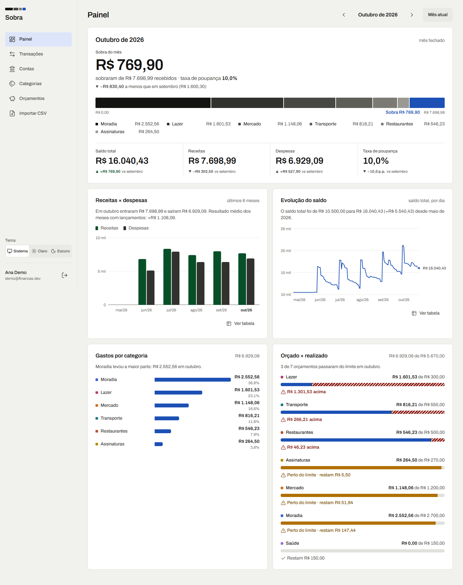

<table>
  <tr>
    <td width="33%">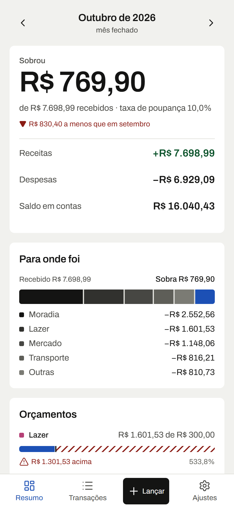</td>
    <td width="33%">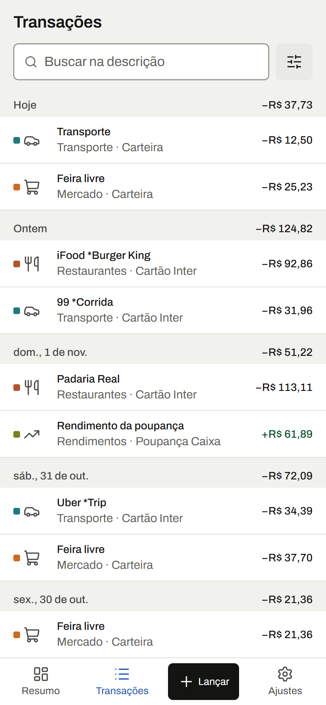</td>
    <td width="33%">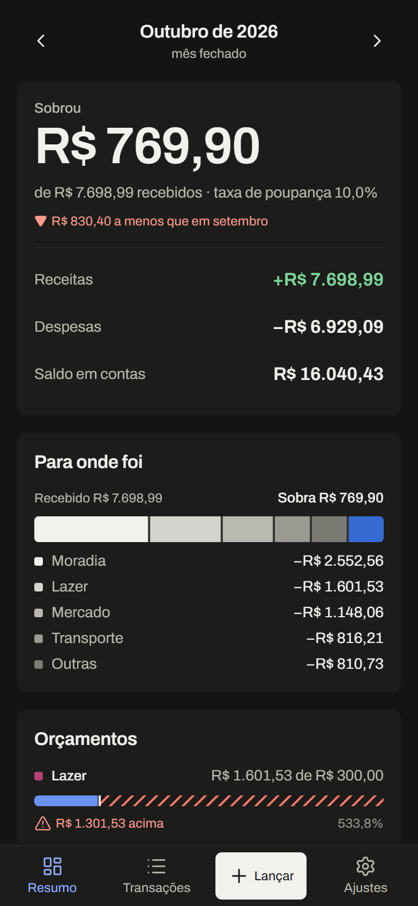</td>
  </tr>
</table>

## O que dá para fazer

**Mobile (Expo, iOS e Android):** lançar um gasto em 3 toques (valor no teclado próprio em
centavos, categoria, salvar), com conta e data já preenchidas; resumo do mês com a régua (receita,
despesas por categoria e a sobra) e orçamentos; lista de transações por dia com busca, filtros,
rolagem infinita e deslizar para editar ou apagar (com desfazer); tema claro e escuro.

**Web (React + Vite):** painel com sobra do mês, saldo, receitas, despesas e taxa de poupança com
variação sobre o mês anterior; receitas × despesas, evolução do saldo, gastos por categoria e orçado
× realizado, cada gráfico com tabela alternativa; tabela de transações com filtros na URL e edição
em painel lateral; contas, categorias, orçamentos (com cópia do mês anterior) e importação de CSV
com prévia antes de gravar; tema claro, escuro ou do sistema, sem flash no carregamento.

**API (Fastify):** cadastro e login com sessão rotativa, CRUD de todo o domínio, recorrências,
resumos, importação de CSV e documentação OpenAPI em `/docs`.

## Rodar em 3 comandos

Requisitos: **Node 22.12 ou mais novo** (testado no 22.14) com **Corepack**, que vem junto com o
Node 22 e 24. Não precisa instalar pnpm nem Docker: o Corepack usa a versão fixada no
`package.json` (pnpm 10.18) e o banco de desenvolvimento é um arquivo SQLite.

```sh
git clone <url-do-repositório> sobra && cd sobra

corepack pnpm install     # dependências + Prisma Client (postinstall da API)
corepack pnpm bootstrap   # cria apps/api/.env, aplica as migrations e semeia o usuário demo
corepack pnpm dev         # API e web juntos
```

Abra **http://localhost:5173** e entre com **demo@financas.dev / demo1234** (o botão "Entrar com a
conta de demonstração" preenche os campos). O demo tem seis meses de dados até hoje.

| Serviço       | Endereço              | Observação                                         |
| ------------- | --------------------- | -------------------------------------------------- |
| Web           | http://localhost:5173 | o Vite repassa `/api` para a API                   |
| API           | http://localhost:3333 | OpenAPI e Swagger UI em http://localhost:3333/docs |
| Expo (mobile) | http://localhost:8081 | só com `corepack pnpm dev:mobile`                  |

Sobre os comandos:

- `bootstrap` e não `setup` porque `pnpm setup` é um comando do próprio pnpm. Ele nunca sobrescreve
  um `apps/api/.env` que já existe e gera um `JWT_SECRET` local aleatório. Rodar de novo recria só
  os dados do demo (o seed é idempotente e determinístico).
- `dev` usa `pnpm --parallel --filter` em vez do `concurrently`: não acrescenta dependência e já
  prefixa cada linha com o pacote (`apps/api dev:`, `apps/web dev:`). O web pode subir antes da API;
  o proxy do Vite só responde erro até a API ficar pronta, um ou dois segundos depois.
- No Windows, clone num caminho curto (por exemplo `C:\dev\sobra`): o layout isolado do pnpm cria
  caminhos longos em `node_modules` e passa do limite de 260 caracteres em pastas profundas
  ([ADR-003](docs/decisoes.md#adr-003--linker-do-pnpm-layout-isolado-padrão)).
- Só três dependências podem rodar script de instalação (`onlyBuiltDependencies` em
  `pnpm-workspace.yaml`): `prisma`, `@prisma/engines` e `better-sqlite3`. O `better-sqlite3` baixa
  binário pronto para Windows, macOS e Linux comuns; numa plataforma sem binário ele tenta compilar e
  precisa de toolchain C++. O fluxo acima foi testado só no Windows 11.

### Mobile

```sh
corepack pnpm dev:mobile  # Metro na porta 8081; com a API rodando (corepack pnpm dev)
```

- **No navegador (Expo web):** aperte `w` no terminal do Expo. O app usa `http://localhost:3333`
  por padrão, então funciona sem configurar nada.
- **No celular com Expo Go:** o celular precisa estar na mesma rede e enxergar a API pelo IP da
  máquina. Crie `apps/mobile/.env` com `EXPO_PUBLIC_API_URL=http://192.168.0.10:3333` (troque pelo
  seu IP), rode `corepack pnpm dev:mobile` e leia o QR code com o Expo Go (versão para o SDK 58). A
  API já escuta em `0.0.0.0`; no Windows, o firewall pode pedir para liberar o Node nas portas 3333 e 8081.

O app foi desenvolvido e validado no Expo web e nos testes com Jest; não foi aberto num aparelho
real (veja [Limitações](#limitações-conhecidas)).

### Com PostgreSQL (Docker)

Existe um `docker-compose.yml` com PostgreSQL 17, mas **esse caminho não foi testado** (a máquina de
desenvolvimento não tem Docker). O schema não usa nada exclusivo do SQLite, porém a troca não é só
de URL ([ADR-010](docs/decisoes.md#adr-010--prisma-7-com-sqlite-via-driver-adapter-postgresql-é-troca-de-provider)):

1. `provider = "postgresql"` em `apps/api/prisma/schema.prisma` (o Prisma não aceita variável de
   ambiente no provider);
2. `@prisma/adapter-pg` no lugar do adapter SQLite em `apps/api/src/lib/db.ts`;
3. aceitar uma URL `postgresql://` em `apps/api/src/config/env.ts` (hoje exige `file:`) e no seed;
4. gerar uma pasta de migrations nova com `prisma migrate dev`, porque migrations são específicas do
   banco;
5. `docker compose up -d` e `DATABASE_URL` apontando para o container.

## Arquitetura

Monorepo pnpm com três pacotes compartilhados e três apps. Os pacotes são consumidos como fonte
TypeScript, sem etapa de build
([ADR-005](docs/decisoes.md#adr-005--financasshared-consumido-como-fonte-typescript)).

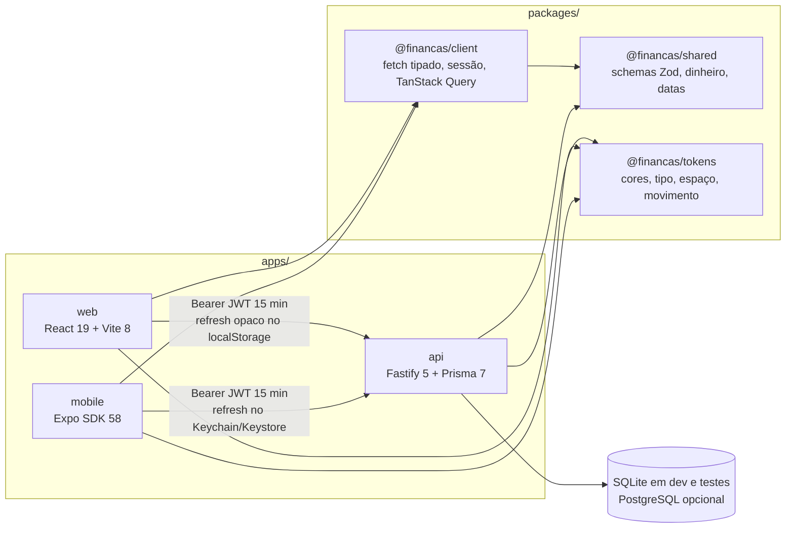

- **Contrato único:** os schemas Zod de `@financas/shared` validam a entrada na API, filtram a saída
  (campo fora do contrato não vaza), geram o OpenAPI e validam a resposta no cliente. Mudou o
  contrato, quebra o typecheck da API, do web e do mobile ao mesmo tempo.
- **Sessão:** access token JWT de 15 minutos e refresh token opaco de 30 dias, rotacionado a cada uso.
  O banco guarda só o SHA-256 do refresh; reapresentar um token já usado derruba a família inteira
  daquele login.
- **Cliente compartilhado:** web e mobile usam o mesmo `@financas/client`; muda só onde os tokens
  ficam (`TokenStore`).

O ponto mais delicado é a renovação de sessão. Com rotação e detecção de reuso, duas renovações
paralelas com o mesmo token encerrariam a sessão, por isso o cliente faz uma só:

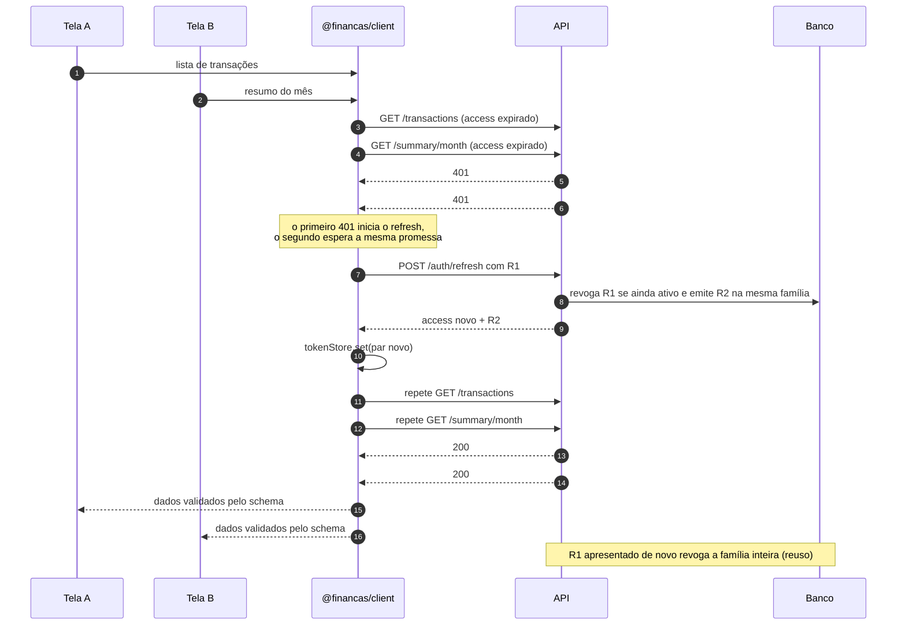

No web há ainda um `navigator.locks` para que abas diferentes também façam um refresh por vez. Se a
API recusar o refresh, o cliente limpa a sessão e volta ao login; falha de rede no refresh mantém a
sessão ([ADR-023](docs/decisoes.md#adr-023--cliente-da-api-compartilhado-financasclient-refresh-single-flight-e-onde-guardar-os-tokens)).
Um teste de integração em `apps/api/src/client.integration.test.ts` mostra que, sem o single-flight,
três requisições concorrentes derrubam a sessão.

## Stack

| Camada        | Escolhas                                                                                       |
| ------------- | ---------------------------------------------------------------------------------------------- |
| Linguagem     | TypeScript 6 estrito (`noUncheckedIndexedAccess`, `exactOptionalPropertyTypes`)                |
| API           | Fastify 5, Prisma 7 (SQLite via driver adapter), Zod 4, argon2id, Swagger UI                   |
| Web           | React 19, Vite 8, React Router 7, TanStack Query e Table, visx, CSS Modules, Sonner            |
| Mobile        | Expo SDK 58, React Native 0.88, Expo Router, Reanimated 4, Gesture Handler 3, react-native-svg |
| Compartilhado | `@financas/shared` (Zod, date-fns), `@financas/tokens`, `@financas/client`                     |
| Testes        | Vitest, Testing Library, axe-core, Jest (jest-expo)                                            |
| Ferramentas   | pnpm 10 via Corepack, ESLint 10, Prettier, GitHub Actions                                      |

## Decisões técnicas

Todas as 33 decisões estão em [`docs/decisoes.md`](docs/decisoes.md). As que mais pesaram:

- **Dinheiro em centavos inteiros, `BigInt` no banco, arredondamento meio-para-o-par.** Nada passa
  por float; R$ 1 bilhão cabe ([ADR-008](docs/decisoes.md#adr-008--dinheiro-parse-por-string-e-arredondamento-half-even),
  [ADR-010](docs/decisoes.md#adr-010--prisma-7-com-sqlite-via-driver-adapter-postgresql-é-troca-de-provider)).
- **Isolamento entre usuários no banco:** FKs compostas `(id, userId)` impedem que uma transação
  aponte para a conta de outra pessoa; recurso alheio responde 404, nunca 403
  ([ADR-010](docs/decisoes.md#adr-010--prisma-7-com-sqlite-via-driver-adapter-postgresql-é-troca-de-provider)).
- **Refresh token rotativo com detecção de reuso**, como recomenda a OAuth 2.0 Security BCP para
  clientes públicos ([ADR-012](docs/decisoes.md#adr-012--sessão-jwt-de-acesso-curto--refresh-token-opaco-com-rotação-e-detecção-de-reuso)).
- **Contrato Zod compartilhado** entre API, web e mobile, com transações como união discriminada e
  mensagens em pt-BR ([ADR-009](docs/decisoes.md#adr-009--contrato-de-dados-ids-uuid-transações-como-união-discriminada-mensagens-em-pt-br),
  [ADR-014](docs/decisoes.md#adr-014--openapi-com-fastifyswagger--swagger-ui-em-docs-gerado-dos-schemas-zod)).
- **Cliente com refresh single-flight e atualização otimista** com rollback, inclusive em listas
  infinitas ([ADR-023](docs/decisoes.md#adr-023--cliente-da-api-compartilhado-financasclient-refresh-single-flight-e-onde-guardar-os-tokens)).
- **Datas como texto `YYYY-MM-DD` no fuso de São Paulo**, para uma compra das 23h30 não cair no mês
  seguinte ([ADR-007](docs/decisoes.md#adr-007--datas-com-date-fns--date-fnstz-sempre-no-fuso-de-são-paulo),
  [ADR-011](docs/decisoes.md#adr-011--data-da-transação-como-texto-yyyy-mm-dd)).
- **Tokens de design com testes de contraste:** todo par texto/fundo dos dois temas tem mínimo WCAG
  verificado (AAA nos números principais) e a paleta de gráficos é testada para daltonismo
  ([ADR-022](docs/decisoes.md#adr-022--tokens-compartilhados-em-financastokens-ts-puro)).
- **Direção visual "Concreto e azulejo" e a régua do mês:** uma família tipográfica, um único azul
  para o dado principal, e a sobra como plano nomeado na régua
  ([ADR-021](docs/decisoes.md#adr-021--direção-visual-concreto-e-azulejo-e-tipografia-archivo)).
- **Mês parcial honesto:** no dia 5 o painel diz "parcial · dia 5 de 30" e "Em aberto" em vez de uma
  taxa de poupança de −1.241% ([DESIGN.md](DESIGN.md#cartão-de-kpi-resumo-do-mês)).
- **Pior caso na fronteira do `fetch`:** valores bilionários, nomes de 120 caracteres, japonês,
  árabe e erro 500 entram pelo mesmo caminho do dado real e viram teste de regressão
  ([ADR-032](docs/decisoes.md#adr-032--polimento-do-web-cenários-de-pior-caso-números-que-encolhem-acessibilidade-testada-e-bundle)).
- **Lançar em 3 toques:** conta, data e descrição têm padrão; só valor e categoria são obrigatórios
  ([ADR-030](docs/decisoes.md#adr-030--lançar-gasto-em-3-toques)).

## Mais capturas

### Tema escuro

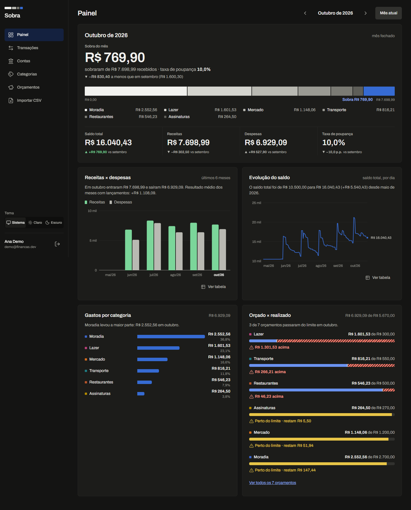

### Transações e edição

<table>
  <tr>
    <td width="50%">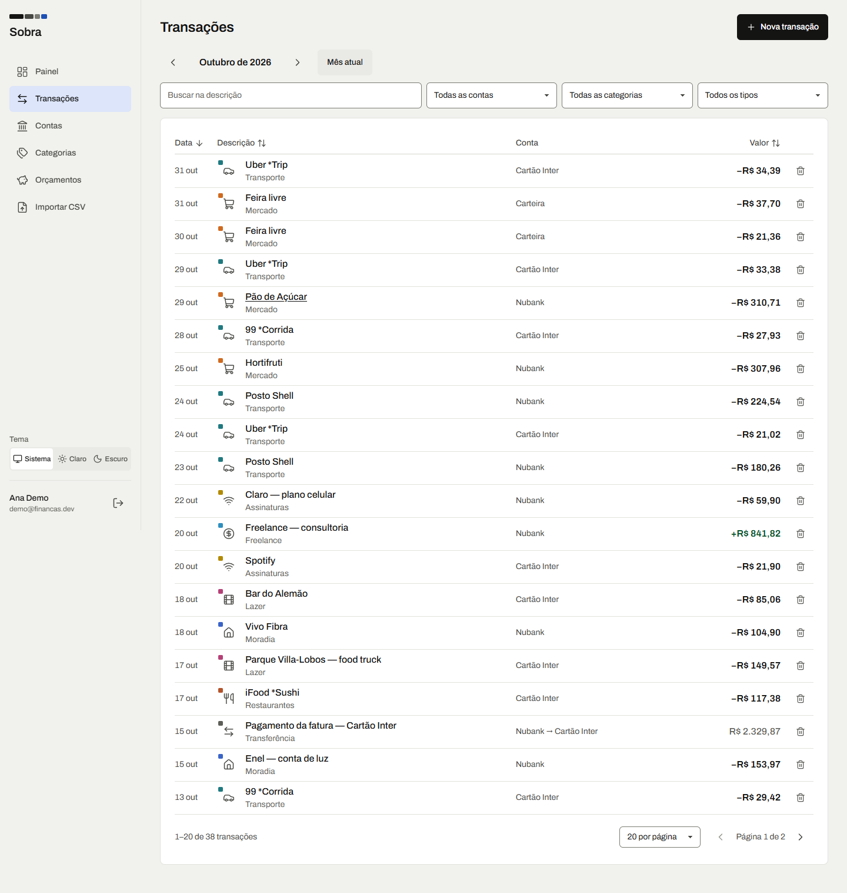</td>
    <td width="50%">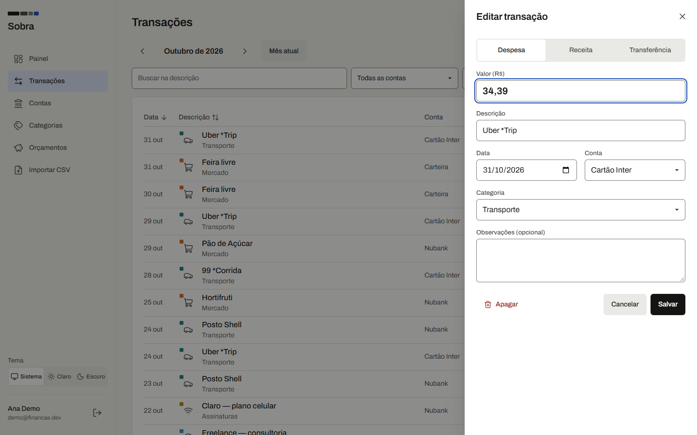</td>
  </tr>
</table>

### Importação de CSV com prévia

Nada é gravado antes da revisão: categoria sugerida por linha, duplicatas desmarcadas e erros
apontados na própria linha.

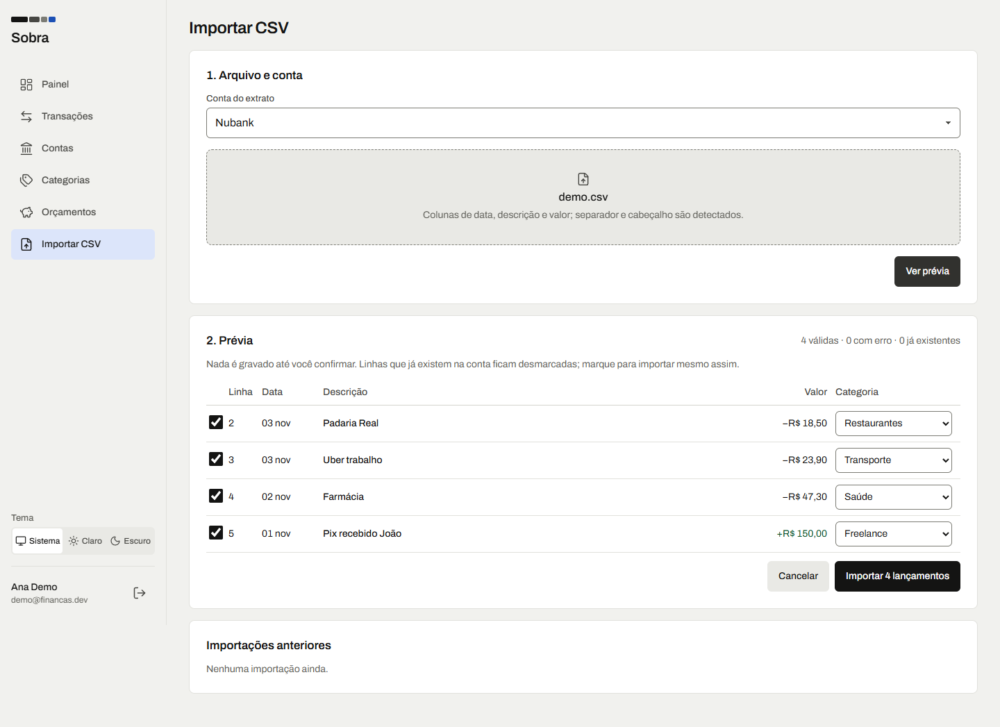

### Lançar em 3 toques

<table>
  <tr>
    <td width="33%">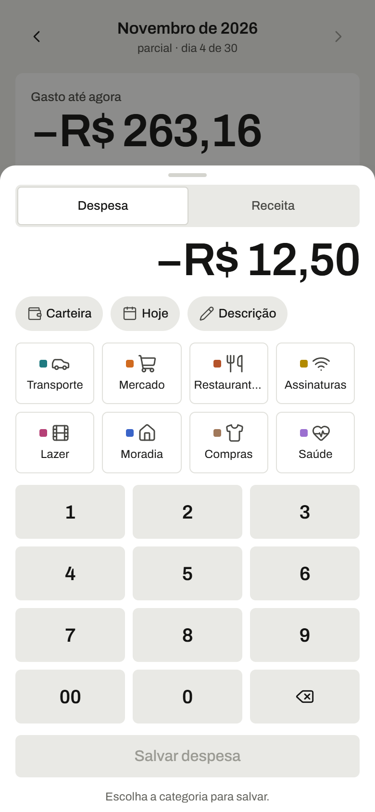<br><sub>1. "Lançar" abre a folha no valor</sub></td>
    <td width="33%">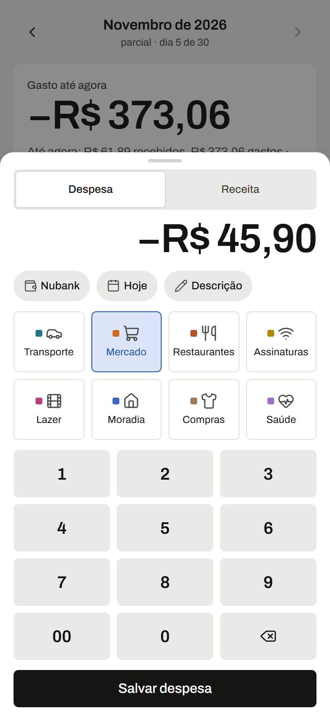<br><sub>2. categoria</sub></td>
    <td width="33%">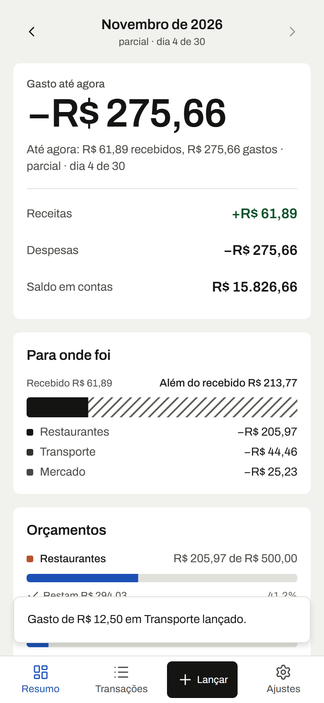<br><sub>3. salvar: entra na hora (otimista)</sub></td>
  </tr>
</table>

### Deslizar para editar ou apagar

<table>
  <tr>
    <td width="33%">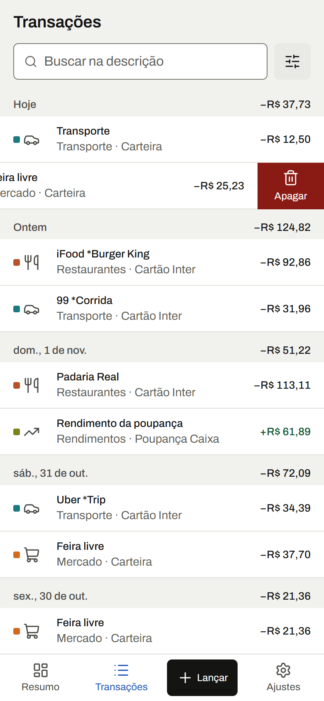</td>
    <td width="33%">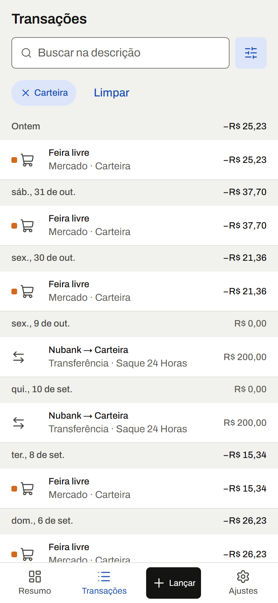</td>
    <td width="33%">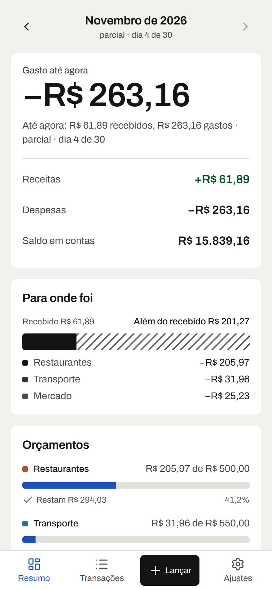</td>
  </tr>
</table>

### Pior caso, antes e depois

Os dois apps passaram por uma rodada de dados extremos (R$ 1.000.000.000,00, nomes de 120
caracteres sem espaço, texto do sistema a 2×). O valor nunca é cortado: ele encolhe até caber.
Relatórios em [`docs/polimento-web.md`](docs/polimento-web.md) e
[`docs/polimento-mobile.md`](docs/polimento-mobile.md).

<table>
  <tr>
    <th>Antes</th>
    <th>Depois</th>
  </tr>
  <tr>
    <td width="50%">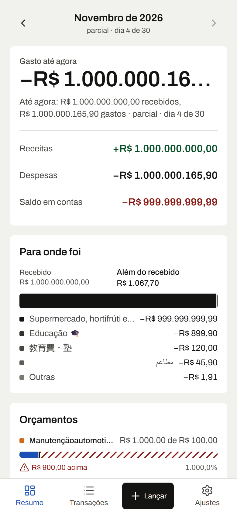</td>
    <td width="50%">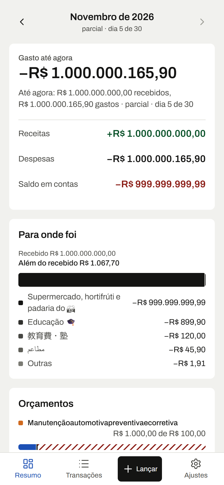</td>
  </tr>
  <tr>
    <td width="50%">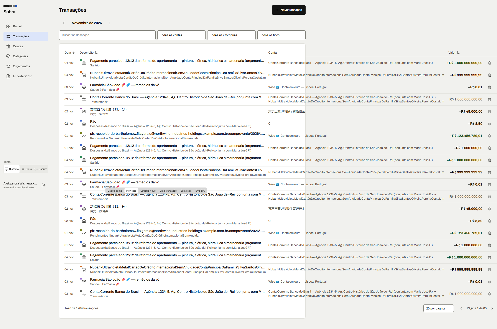</td>
    <td width="50%">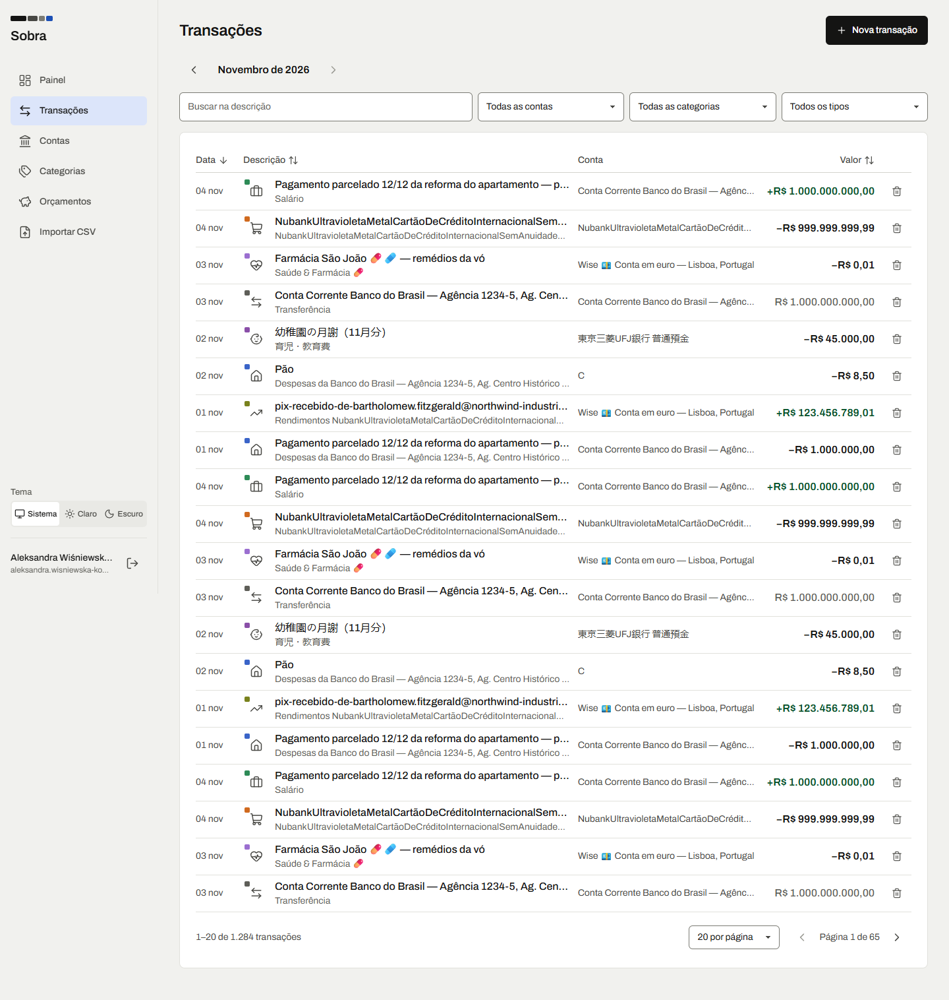</td>
  </tr>
</table>

## Qualidade

`corepack pnpm test` na raiz roda **895 testes**, todos passando:

| Pacote             | Testes | O que cobre                                                                    |
| ------------------ | -----: | ------------------------------------------------------------------------------ |
| `@financas/shared` |    267 | dinheiro (parse, half-even, rateio), datas no fuso, schemas do contrato        |
| `@financas/tokens` |    225 | contraste WCAG dos dois temas, ΔE da paleta para daltonismo, CSS gerado        |
| `@financas/client` |     50 | single-flight, sessão expirada, erros pt-BR, invalidações, otimista e rollback |
| `apps/api`         |    132 | rotas pela API real (SQLite por arquivo), isolamento entre usuários, seed      |
| `apps/web`         |     82 | telas com API falsa, pior caso, axe-core sem violação séria ou crítica         |
| `apps/mobile`      |    139 | lançar, lista, folha, acessibilidade (nomes, papéis, anúncios), contraste      |

- **Typecheck estrito** em todos os pacotes (`corepack pnpm typecheck`), ESLint e Prettier na raiz.
- **Acessibilidade:** axe-core roda nos testes do web; numa passada no Chrome real com
  `@axe-core/playwright` (claro/escuro, 1440/390 px) foram 0 violações. No mobile, rótulos, papéis e
  anúncios para leitor de tela são testados.
- **CI:** `.github/workflows/ci.yml` roda install congelado, format:check, lint, typecheck e test.
  O workflow existe, mas **ainda não rodou no GitHub**, porque o repositório não foi publicado; os
  mesmos comandos passam localmente.

## Como foi feito

O código foi escrito por agentes de IA (Claude Code) num fluxo em dupla: um agente planejador divide
cada fase e valida a entrega com evidência própria (roda os testes, abre as telas, confere as
capturas) antes de aprovar, e agentes executores implementam e reportam. Quando o planejador
discorda, a entrega volta para revisão. A conversa entre eles está em [`.dupla/`](.dupla/), cada
decisão relevante virou um ADR em [`docs/decisoes.md`](docs/decisoes.md) e cada fase é um commit
(fundação do monorepo, contrato compartilhado, API, direção de design, cliente, web, mobile,
polimento). O produto e a direção visual estão em [`PRODUCT.md`](PRODUCT.md) e
[`DESIGN.md`](DESIGN.md).

## Limitações conhecidas

- **Mobile sem teste em aparelho real.** Foi validado no Expo web e com Jest. Sensação dos gestos e
  hápticos, Dynamic Type e fonte do Android de verdade, VoiceOver/TalkBack e o teclado do iOS sobre
  a folha ainda precisam ser conferidos num celular.
- **Refresh token no `localStorage` no web.** Um XSS poderia lê-lo; a rotação com detecção de reuso
  reduz o estrago, mas o caminho certo antes de um deploy público é cookie `httpOnly` com proteção
  CSRF ([ADR-023](docs/decisoes.md#adr-023--cliente-da-api-compartilhado-financasclient-refresh-single-flight-e-onde-guardar-os-tokens)).
- **SQLite em desenvolvimento; PostgreSQL não testado.** A troca exige os passos descritos acima.
- **Sem deploy e sem build nativo.** Não há ambiente publicado, EAS Build nem app nas lojas; o CI
  nunca rodou.
- **Sem modo offline.** Lançar sem conexão falha com mensagem e "Tentar de novo"; uma fila offline é
  decisão em aberto.
- **Pequenos pontos documentados:** duas mutações otimistas sobrepostas em que a primeira falha
  desfazem a segunda na tela até a próxima leitura; usuário que apaga todas as contas não tem um vazio
  que leve a "Nova conta"; testado só no Windows 11 e só em pt-BR/BRL.

## O que eu aprenderia em seguida

1. **Testes E2E no CI com Playwright** cobrindo login, lançamento e importação contra a API real,
   com o axe no navegador em vez de só no jsdom.
2. **E2E no mobile com Maestro ou Detox**, rodando num emulador Android no CI.
3. **Sessão web com cookie `httpOnly` + CSRF**, API e web no mesmo site.
4. **Deploy de verdade:** API em Fly.io ou Render, PostgreSQL gerenciado (Neon), migrations no
   pipeline e builds do app com EAS.
5. **Observabilidade:** logs estruturados com correlação de requisição, métricas e rastreamento com
   OpenTelemetry, alertas de erro (Sentry) nos três apps.
6. **Sincronização offline no mobile:** fila de lançamentos com IDs gerados no cliente e resolução
   de conflito.
7. **i18n e outras moedas**, separando formatação de dinheiro e datas do pt-BR fixo.

## Licença

[MIT](LICENSE).
